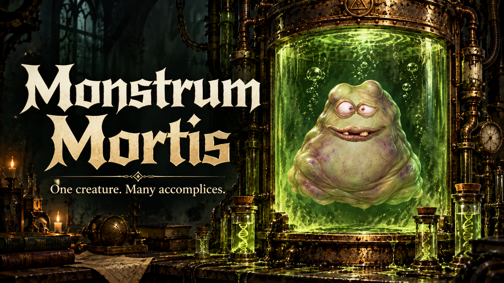

**Monstrum Mortis** is an entry in Handshake’s [Create a Multiplayer Game with OpenAI](https://joinhandshake.com/learn/create-a-multiplayer-game-8d7d59b5/) competition.

A real-time cooperative browser party game for 2–8 players. Become questionable scientists, inject mysterious DNA into one shared creature, and unleash your creation into automatic battles. Sinister machinery meets ridiculous mutations across three rounds, with team victories and personal awards. No accounts or installation—just gather your accomplices and see what survives.

[Play Monstrum Mortis](https://monstrum-mortis.scott-jeffrey-miller.workers.dev) · [Entry description](docs/COMPETITION-ENTRY.md) · [Cover artwork provenance](assets/project-cover/provenance.json)

The approved Phase D simplification replaces private invitations/automatic ready queues with named public forming labs and compact specimen controls. Start with 2–8 people; a remaining scientist can finish the session. [Approved rules](docs/APPROVED-PLAN.md), [actual implementation/deployment status](docs/IMPLEMENTATION-STATUS.md), [architecture](docs/ARCHITECTURE.md), [battle specification](docs/BATTLE-V2-SPEC.md) and [completed release acceptance](docs/BATTLE-V2-PHASE-D-ACCEPTANCE.md).

Use Node 24 and the committed lockfile:

```sh
npm ci
npm run check
npm run build
npm run dev:worker
```

Open the reported Worker address using separate browser profiles/devices; create a public lab and choose its name in the other browser. For Vite development, run `npm run dev` in a second terminal. `/art-gallery`, `/combat-gallery`, `/specimen-gallery` and `/battle-v2` are development-only studies, excluded from production.

```sh
npm run test:simplification
npm run test:composition
npm run simulate:combat
npm run measure:phase-d
```

The current public-only runtime/browser aggregate supersedes private/queue UI tests; previous scripts/checks are retained as historical material under tests/archive and docs/archive. DNA/combat/selector/animation unit regressions remain part of `npm run check`.

Step 6 and Battle v2 Phases A–D are complete for the accepted scope; the game is deployed at [workers.dev](https://monstrum-mortis.scott-jeffrey-miller.workers.dev). See acceptance for the exact tested release and limitations. Future deployment requires an explicit user instruction. Keep Workers Free, SQLite Durable Object identities and bindings, and self-hosted scottjmiller.com/www unchanged. Never commit credentials. Saved monsters/cards/cabinet are cancelled.
