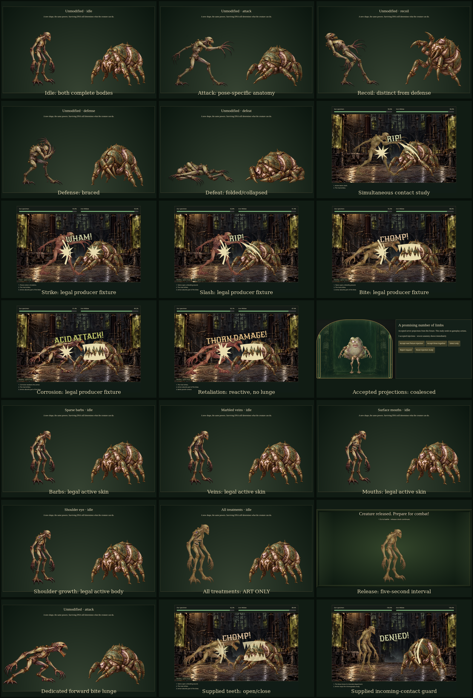

# Battle v2 Phase A review

**Phase A remains the review milestone.** Updated 13 October 2026 after the user's sound, effect, lettering, grounding and bite-pose feedback. Production play, mechanics, admission, recovery, protocol/schema/rules, infrastructure and experimental anatomy are unchanged. No deployment. [Specification](BATTLE-V2-SPEC.md) defines requirements; [plan](BATTLE-V2-PLAN.md) records decisions and the review gate.

## Play the revised sample

```sh
npm run dev
# Open http://127.0.0.1:5173/battle-v2
```

The current local session runs at **http://127.0.0.1:5174/battle-v2**. Click Enable sound, unmute if needed, then Play recording. It requires no Worker or credentials. Preview sound / Play selected sound auditions each foreground cue, including `result`; ambience loops after unlock. In Pose and modifier registration, select the attack role and Forward bite lunge to inspect the new variant and its overlays/mirroring. Timeline fixtures and isolated choreography studies remain labeled. Sound settings are per device. Seek directly to any time; previous sounds do not replay.

Offline preparation and verification:

```sh
npm run prepare:battle-v2
npm run test:battle-v2
npm run review:battle-v2
```

Node 24 and the committed npm lockfile are required. Chrome/Chromium is needed for browser checks (`MM_CHROME_PATH` overrides the executable). Preparation uses Python 3, ImageMagick and FFmpeg, with retained originals; it does not regenerate AI artwork or make runtime third-party requests. Review assembles actual browser captures. The production build excludes the preview and its assets.

## Changes from the first sample

- Replaced the five hand-coded battle graphics and guard arc with the six supplied SVGs. Original parchment `#e9ddaf`, opacity, shapes, transforms and aspect ratios are preserved. Editor metadata is removed and each effect gets a uniform arena footprint. Upper/lower bite rows are separate derivatives of the original SVG, meeting at contact, opening in recoil and closing again against the seekable clock. Reduced/static motion keeps them closed.
- Placement follows the user’s clarification: block/retaliation stay on the defending creature (event actor); offensive graphics stay on the attacked creature (event target). Orientation follows the acting creature independently: left attacks use original SVGs on the right target; right attacks use mirrored SVGs on the left target. Left defenses use original SVGs on the left defender; right defenses use mirrored SVGs on the right defender. Graphics follow the owning body’s decorative movement; lettering stays unmirrored. Dodge has no effect graphic; defense pose, miss caption and sound remain. Effect/lettering caps and simultaneous contact timing are unchanged.
- Lettering chooses from all 21 requested phrases across strike, slash, bite, corrosion, retaliation, defeat, block, miss and timeout/result. Cosmetic pseudorandom choice uses public event identity, stays fixed for that event across frames/seek/reload, and does not use hidden combat entropy or change the timeline. Block/miss/result join the prominent lettering candidates while retaining priority and the one-word cap. The new timeout study is labeled choreography, not a generated outcome.
- Lettering now uses **New Rocker, Georgia, Times New Roman, serif**, with the Google font bundled unchanged and its SIL OFL license retained. Font loading/failure does not gate the timeline or controls.
- Strike, guard, recoil and defeat now have a **1.15 playback-gain multiplier** (15% amplitude increase). Source/encoded files and other cues are unchanged; local volume/mute and the limiter still apply.
- Replaced all fourteen procedural cues with the supplied sounds. Archived masters stay untouched. Offline analysis balances active RMS with linear gain, preserves dynamics/stereo, caps pre-encode peaks and rechecks decoded AAC overshoot. Tiny edge fades remove abrupt starts/tails; ambient has 20ms loop-edge fades. Identical-channel bite/miss sources use one unchanged channel, avoiding a downmix boost. Device mute/volume, voice bounds, limiter and ambient ducking remain.
- Removed both large floor-shadow disks. Original grounded pose pivots and arena feet remain; no new gameplay movement or deadline is introduced.
- Produced a dedicated family-1 forward bite-lunge sprite with the built-in imagegen tool/skill, using the existing idle master as identity reference. It has its own foot, torso, eye and shoulder registration. Actual bite events select this attack variant; slash/strike use the existing attack art. Iron Widow still has its original five roles. Drawing teeth does not grant a bite ability.
- Added preview-only sound audition and attack-artwork selectors. No production controls or debug endpoint.

The all-30-DNA surviving-vote selector/modifier registry remains unchanged, server-only and unwired. Uniform highest ties, active-only modifiers, one Titan scale, fixed tints and no-vote blob remain tested. Future persisted selection once per frozen attempt is Phase C work, not a current production capability.

## Non-tint overlays: discussion remains open

**Barbs, veins, surface mouths and shoulder growth are Phase A review samples, not final production artwork.** The first three are original SVG surface treatments; the growth reuses the approved experimental Existential Organ with a wandering pupil. They remain in the revised sample, fitted to the new bite pose too. Tint treatments are unchanged.

The user selected **textured anatomical grafts matching the creature artwork** for the next pass. The proposed treatment is sparse rooted skin spikes, embedded marbled veins, three fleshy mouths with grafted edges covering the approved area, and a shoulder growth with a convincing flesh root and matching light/decay. Preserve active-slot competition, opacity, pose registration and bounded layer usage. These overlays were not replaced in this sound/effect/bite refinement and their final appearance has not been approved.

## Actual rendered evidence

Compared the first and revised captures for lettering, effect silhouettes/color, full bite anatomy, feet, layering, phone framing and pose registration. Inspected the actual timestamped motion frames and captured audio waveform; automated assertions alone do not establish artistic quality. Complete upper/lower teeth remain readable; primary controls and health sit outside major lettering. Intentional impact occlusion remains in simultaneous exchanges.

- [Before contact sheet](battle-v2-review/initial-phase-a/contact-sheet.png) and [before recording](battle-v2-review/initial-phase-a/phase-a-recording.mp4).
- [Revised contact sheet](battle-v2-review/contact-sheet.png), [modifier sheet](battle-v2-review/modifier-contact-sheet.png), [browser motion/audio recording](battle-v2-review/phase-a-recording.mp4), and [timestamped motion frames](battle-v2-review/motion-frames.png).
- [Lettering contact sheet](battle-v2-review/lettering-contact-sheet.png) shows all nine families in the actual renderer.
- [Miss lettering](battle-v2-review/lettering-dodge.png), [block lettering](battle-v2-review/lettering-block.png), [defeat lettering](battle-v2-review/lettering-knockout.png), and [timeout/result lettering](battle-v2-review/lettering-timeout.png).
- [Placement/orientation comparison](battle-v2-review/placement-contact-sheet.png): left/right block, retaliation and attack graphics.
- [Bite contact](battle-v2-review/bite-contact.png), [teeth opening](battle-v2-review/bite-open.png), [unmodified bite pose](battle-v2-review/bite-modifier-0.png), [growth registration on bite](battle-v2-review/bite-modifier-8.png), and [supplied guard](battle-v2-review/effect-block.png).
- [Desktop](battle-v2-review/desktop.png), [phone portrait](battle-v2-review/phone-portrait.png), [phone landscape](battle-v2-review/phone-landscape.png), [phone reduced](battle-v2-review/phone-reduced.png), and [desktop static](battle-v2-review/desktop-static.png).
- [Captured audio levels](battle-v2-review/audio-evidence.json), [browser timing/memory](battle-v2-review/browser-evidence.json), and [artifact hashes](battle-v2-review/review-evidence.json).



## Asset readiness, measurements and provenance

| Asset | Actual Phase A state |
| --- | --- |
| Family 1 / Iron Widow | Ten original five-role sprites plus one real family-1 bite variant, individually registered and rendered |
| Arena / apparatus panel | Finished and integrated |
| Six supplied effect SVGs | Strike, slash, bite, corrosion, retaliation and block integrated; eight derivatives including two tooth rows |
| New Rocker | Bundled unchanged font, SIL OFL license; fallback tested |
| Fourteen supplied sounds | Balanced/compressed AAC-LC, gesture playback and decode verified; subjective listening remains outstanding |
| Non-tint overlays | Existing sample treatments, textured-graft direction selected, not final acceptance |
| Animated blob | Existing idle animation; complete battle poses remain planned |
| Other families/rivals/effects/arenas/damage variants | Planned Phase B |
| Production presentation/selection persistence/UI | Planned Phase C |

Source SVGs total **23,357 bytes**; eight runtime derivatives total **17,668 bytes**, including both the complete bite reference and separate rows. Supplied PCM sounds total **2,344,916 bytes**, reduced to **230,726 bytes** of AAC (about **90% smaller**). Original rate is 22,050Hz. Stereo is preserved except identical channels; mono uses 48kbps, stereo 64kbps. Most decoded foreground active RMS is near −20dBFS; corrosion remains around −23.3dBFS to retain transient headroom. Decoded individual peaks stay below −5dBFS in this final set. Device gain/limiting still applies. Ambience targets −32dBFS. Tiny fades preserve overall duration, not authoritative timing.

Selected runtime media total **1,535,198 bytes**: 761,418 pose bytes, 347,034 arena/panel, 5,128 growth, 230,726 audio, 17,668 SVG and 173,224 font bytes. Fourteen rasters plus seven used SVG URLs preload independently of time; font loading swaps independently. Eleven pose images have 3,385,809 pixels (13,543,236 bytes for one RGBA copy, not measured total memory). Browser decoded audio is **9,976,812 bytes**. The captured mix has headroom at device volume 0.70; current exact levels and viewport timing are retained in the linked evidence JSON files. Local p95 frame intervals have been about 16.7–16.8ms. These are local desktop Chrome observations, not physical-device, GPU, Cloudflare quota or subjective sound-quality evidence.

Exact bite prompt/reference/tool, untouched masters and source hashes are in [generation.json](../assets/battle-v2/generation.json). Crop/derivative hashes and per-pose pivots/registrations are in [derivatives.json](../assets/battle-v2/derivatives.json) and [art.json](../src/assets/battle-v2/art.json). Supplied input/archive hashes and analysis are in [audio-provenance.json](../assets/battle-v2/audio-provenance.json) and [effect-provenance.json](../assets/battle-v2/effect-provenance.json); the original submitted files remain in [SJM_change-files](battle-v2-review/SJM_change-files). Supplier creation tools/prompts and original licensing were not specified; records do not invent them. [Font provenance/license](../assets/battle-v2/font-provenance.json) cites the official Google files. [Overlay provenance](../assets/battle-v2/overlay-provenance.json) retains original treatments/approved growth reuse. Prior procedural masters/formulas and [initial review](battle-v2-review/initial-phase-a/REVIEW.md) are archived. Generated bite art remains subject to applicable OpenAI terms. No paid/runtime generation dependency or new hosting service.

## Checks actually run for this refinement

- `npm run check` passed config guard, both TypeScript projects and all test files. Explicit `node --test --test-isolation=none tests/*.test.ts` passed **203 individual tests**. New checks verify independent bite artwork, semantic variant/contact/jaw seeking, supplied SVG source/runtime hashes/color/passive content, licensed font, compressed sound hashes/source preservation and decoded peak bounds.
- `node tests/battle-v2.browser.mjs` passed **ten scenarios**, **72 pose/modifier presentations**, actual alpha checks at all 22 produced eye/torso points, all five attack effects in both directions, defensive/offensive placement and acting-side orientation, no dodge graphic/shadow disks, opening/closing teeth and reduced/static, actual bite variant, font load/fallback, all nine lettering families, stable phrase selection on seek/reload, phone phrase fitting, result-sound audition, actual per-cue Web Audio gain-node verification (four 1.15 multipliers, unchanged other cues), gesture/mute/volume/settings, voice cap, hidden-tab seeking, simultaneous contacts, asset failure/retry/loading, desktop/phone portrait/landscape, keyboard and automated WCAG scans. Actual motion/audio was recorded, not inferred from successful decoding alone.
- `node tests/combat.browser.mjs` passed **six existing production scenarios**: real independent clients, battle synchronization/reload, host progression/results/replay, rival gallery, reduced/static and graphics retry.
- `npm run build` passed. `node scripts/check-battle-v2-build.mjs` inspected **93 production files**, finding no preview modules/media/fixtures/debug route. Production JS/CSS chunk filenames/hashes match the initial Phase A baseline.
- Audio preparation decoded every encoded file and measured levels, channels, size/compression and abrupt endpoints. Review assembly muxed actual browser video/audio and generated contact sheets. Documentation-link and whitespace checks completed at delivery.

Initial iterations exposed an import-attribute error and a development control-label mismatch; corrected code passed the final checks. No Worker changes occurred, so no new dry run or runtime suite was needed for this refinement. The full step 6 aggregate/dry run passed on **10 October**, retained as historical evidence in implementation status and the initial review; it was not rerun here. No deployment occurred.

This environment cannot perceptually audition audio input. Listening for timbre, compression artifacts, loop seams and relative prominence remains human review. Physical phones, Safari/Firefox, manual screen readers, GPU/loading and broad load/free-tier measurements remain outstanding. Supplied sounds are genuinely played/captured locally; no physical-device or subjective listening acceptance is asserted.

## Acceptance and subsequent phases

Stop here for **Phase A visual/audio review**, including the pending non-tint overlay discussion. This revision does not constitute Phase B/C authorization.

After sample acceptance, Phase B produces the remaining five player sets (including blob), five rivals, remaining effects/audio, damage/melt/detachment/shatter registration and two arenas. Phase C freezes first, atomically persists one versioned selected form/background before broadcast, preserves it through retries/reload/reactivation and handles legacy compatibility without rerolls. It integrates production playback/audio/UI, routes only new matchmaking entries to Americas and removes new Same-Room/display entry while preserving existing guest/display recovery. Phase D covers physical-device/accessibility/audio unlock/performance/pacing and free-tier measurements. Deployment requires a separate instruction; cards/cabinet/naming remain outside this work.

Human review: audition all cues on your devices, inspect the bite and guard in both directions, compare the before/after sheet, test portrait/landscape and reduced motion, return after tab sleep, and discuss each textured overlay. The local preview binds loopback; LAN access requires intentionally starting Vite with an appropriate host.
