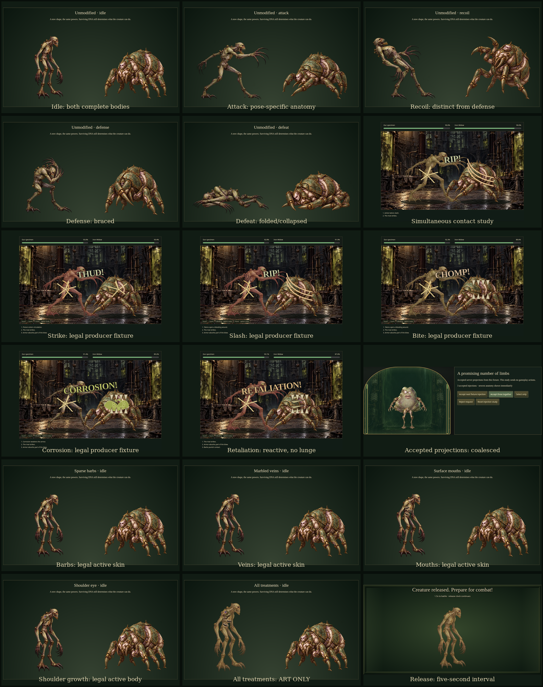
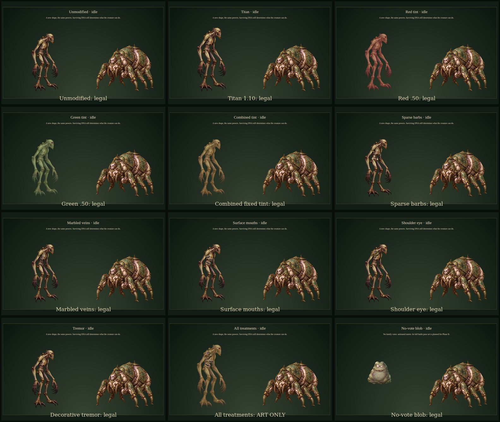

# Battle v2 Phase A review

**Phase A is the review milestone.** This is a functioning development animation/audio sample, not the completed redesign or a production rollout. [The canonical specification](../../BATTLE-V2-SPEC.md) governs requirements; [the plan](../../BATTLE-V2-PLAN.md) records accepted defaults, implementation decisions and next phases. Production mechanics, experiment artwork, protocol/schema/rules, hosting and entry behavior are preserved. No deployment occurred.

## Play the sample

Use Node 24, the committed npm lockfile and an installed Chrome/Chromium for browser checks (`MM_CHROME_PATH` overrides the executable). The preview itself works through Vite and needs no Worker, credentials or image/audio generation service.

```sh
npm run dev
# Open http://127.0.0.1:5173/battle-v2
npm run test:battle-v2
npm run review:battle-v2
```

Enable sound by a deliberate click on each device, then Play recording. Seek the recording, choose an actual producer fixture or a labeled choreography study, inspect Accepted injection feedback, or inspect Pose and modifier registration. Mute/volume are device-local. Recording controls affect this development recording only. The production player has no debug controls or new endpoint. The current review session also started a local preview at http://127.0.0.1:5174/battle-v2; it is not a public deployment.

`npm run prepare:battle-v2` regenerates deterministic fixture projections, optimized art and authored audio from retained source files. It does not call image generation. `npm run test:step6` verifies the preserved service/mechanics baseline. `npm run review:battle-v2` assembles screenshots/contact sheets and muxes captured motion/audio; Python 3, ImageMagick and FFmpeg are needed only for these offline production/review scripts. Tests run real local Chrome; physical devices are separate evidence.

## What changed

- Installed the complete specification and reconciled AGENTS, approved plan/status, architecture, handoff, README and historical presentation notes. Earlier battle appearance, region-selection, Same-Room and display-entry guidance is explicitly superseded for future phases; original verification remains historical.
- One operative DNA-family/modifier registry covers all 30 IDs. A pure server-only selector reads logical surviving targets, deduplicates paired/reinforced mutations, uses unbiased rejection sampling among highest positive ties, and derives active-only modifiers. It never mutates mechanical input and has no production caller. No client entropy or private catalogue import. Phase C must persist selection once before broadcast; Phase A does not claim that new persistence behavior is implemented.
- Produced family 1 and Iron Widow in five distinct pose roles. Feet/pivots, torso polygons, shoulder roots and protected eye regions are individually registered. Shared time determines anticipation, lunge, contact, recoil/guard and recovery; defeat preempts recovery. Simultaneous exchanges show both attacks/reactions. The decorative contact hold never stops the timeline.
- Added a finished arena and instrument-panel painting with live semantic HTML controls, five working directional attack effects, bounded aged comic lettering, captions and bundled sound. Effects mirror independently of words. Damage ticks receive compact captions rather than giant lettering. Remaining effects are explicitly marked planned in the sole effect/sound registry.
- Added coalesced 800ms accepted-injection fluid/quiver feedback and the existing five-second integration reveal. Selection, rejection and replay do not pretend acceptance. Integration has no fluid pulse. Seeking and hidden-tab resumption jump directly to the current frame without a visual/audio backlog.
- Thirteen sample images preload independently of time. Artwork failures retain readable controls/health with retry. Audio uses gesture unlock, local mute/volume, bounded voices, ambient ducking and output headroom/limiting; blocked audio does not prevent preview use. Reduced/static presentation suppresses decorative transforms, particles, quiver and illumination movement.

The ten timelines comprise five actual existing combat-producer fixtures and five labeled isolated choreography studies (simultaneous contacts, miss/guard, defeat, support, and reversed effect directions). Producer fixtures use deterministic UUIDs and a normalized clock: accepted doses precede release at 0, then combat starts at 5,000ms. No study submits outcomes to a room. Twelve modifier studies include eleven legal active-slot fixtures and one explicitly incompatible art-only sampler. All five pose roles were inspected; the blob study has animated existing starter art, not a fabricated full combat pose set.

## Review evidence

These are real browser renders. Inspected complete silhouettes, grounded feet, five distinct roles, torso/shoulder registration, mirrored anatomy, opaque overlays, fixed tints, directional contact effects, readable words/health and phone framing. The original idle sheet touched the skull edge; a complete high-resolution idle master replaced that derivative while preserving both sources. Reusing the approved Existential Organ for the shoulder growth improved its texture match over the initial vector study. Final review captures supersede `first-look.png`, which remains an early iteration record.





- [Actual browser motion and audio recording](phase-a-recording.mp4) and [timestamped motion frames](motion-frames.png), with [source browser audio capture](live-audio.webm).
- [Audio capture levels](audio-evidence.json) and [review artifact hashes](review-evidence.json) retain the final evidence. The captured mix peaks at −9.6 dBFS at device volume 0.70; this measurement does not establish subjective sound quality.
- [Desktop](desktop.png), [phone portrait](phone-portrait.png), [phone landscape](phone-landscape.png), [phone reduced motion](phone-reduced.png), and [desktop static](desktop-static.png).
- [Accepted injections](accepted-injection.png), [integration start](integration-start.png), [mid-reveal](integration-reveal.png), and [unleash](integration-unleash.png).
- [Simultaneous contacts](simultaneous.png), [miss](miss.png), [defeat](defeat.png), and [mirrored shoulder registration](mirrored-growth.png).

## Actual asset readiness and provenance

| Inventory | Phase A readiness |
| --- | --- |
| Family 1 / Iron Widow | Ten real transparent pose derivatives; five roles each, integrated and browser-tested |
| Arena / instrument panel | Two finished generated paintings, integrated |
| Shoulder growth | Approved generated Existential Organ reused at pose-specific roots; wandering pupil is original code |
| Barbs / veins / mouths | Original SVG treatments clipped/registered to each produced family-1 torso; fully opaque |
| Size / tints / tremor | One 1.10 scale, fixed 50% palette treatments with eye protection, occasional decorative motion |
| Strike / slash / bite / corrosion / retaliation | Working reusable directional visuals, major lettering and sound; both directions inspected |
| Dodge / guard / defeat | Functional pose/reaction and sound studies |
| Sound | Fourteen original procedural WAVs, ambient/mechanical/injection/release/sample effects/reaction/result cues |
| Animated blob | Existing starter art with idle quiver/breathing fallback; full five-pose battle set planned |
| Remaining player/rival sets, arenas, effects, damage variants | Planned Phase B; no readiness claim |
| Production selector/persistence/UI/audio | Planned Phase C; current production manifests/contracts unchanged |

Exact built-in imagegen prompts/references, retained masters and hashes are in [generation.json](../../../assets/battle-v2/generation.json); individual crops, derivative hashes, sizes, pivots and registration are in [derivatives.json](../../../assets/battle-v2/derivatives.json) and the [sample render index](../../../src/assets/battle-v2/art.json). The corrected idle prompt is retained separately and included in generation provenance. Existing growth origin/prompt is in [the original ledger](../../../assets/provenance.json); no original experimental file was modified. Overlay implementation/provenance is retained in [overlay-provenance.json](../../../assets/battle-v2/overlay-provenance.json). Audio recipes/seeds/formulas and hashes are in [audio-provenance.json](../../../assets/battle-v2/audio-provenance.json) and its original production script. Generated illustrations remain subject to applicable OpenAI terms; no third-party stock license or exclusivity is asserted. No runtime generation, paid dependency, required user-supplied asset or new hosting service.

Media totals: **1,523,084 bytes** (684,766 ten-pose bytes, 347,034 arena/panel bytes, 5,128 growth bytes, 486,156 audio bytes). Ten pose images contain 3,049,273 pixels: 12,197,092 bytes for one RGBA copy, not measured total browser memory. Audio decode memory and desktop/phone-viewport frame samples are retained in [browser-evidence.json](browser-evidence.json). These are desktop Chrome observations, not physical-phone performance or Cloudflare quota measurements. Hard bounds are three effects, one major word, three current captions and eight foreground audio voices. Sources/review artifacts do not deploy.

## Checks actually completed

- Baseline `npm run check` and `npm run build` passed before implementation. Reviewed a clean tree and fetched upstream without overwriting files.
- Final `npm run test:battle-v2` passed: configuration guard, both TypeScript projects, **199 unit checks**, **eight browser scenarios**, production build and explicit exclusion inspection. Browser evidence includes 60 pose/modifier presentations, actual torso/eye alpha registration, all five finished effects in both directions, simultaneous contact, miss/guard/support/defeat, injection coalescing, seeking/hidden-tab recovery, keyboard, phone portrait/landscape, reduced/static, sound controls/persistence/voice bounds, blocked sound and failed/slow asset recovery. WCAG automated scans passed; manual screen-reader/device review remains outstanding.
- `npm run test:step6` passed, exit 0: dry run with unchanged four bindings (**158.07 KiB raw / 37.15 KiB gzip**), 13 room runtime scenarios, seven matchmaking, authenticated recovery, fresh admission, nine DNA runtime, nine presentation browser, eight DNA browser/all 30 mutation appearances, art gallery, six combat runtime, six combat browser, 48 authoritative compositions plus 12 reference samplers, and 4,536 seeded combat simulations. The aggregate's initial check had 196 unit cases; the final 199-case check includes the subsequently added asset/direction assertions. Earlier historical reports were not overwritten; the rerun simulation is [retained separately](baseline-simulation.json).
- Production exclusion checked 93 built files: no sample JS/CSS/media/fixture markers, production debug endpoint or imported server selector. Production JS/CSS chunk hashes match the initial build. Health and protocol/schema/rules remain the baseline.
- Actual browser Web Audio output was recorded and analysed; an initial overlapping-cue capture reached the clipping ceiling, then the corrected mix/limiter capture had headroom. Detailed current capture levels, frame observations and review hashes are recorded in the evidence files. This environment cannot audition audio input perceptually; subjective listening/timbre/pacing approval remains the user's review, not an asserted human listening check.
- `npm run review:battle-v2` produced the labeled contact sheets and muxed browser recording. `git diff --check` and documentation-link checks passed.

The known local Miniflare alarm-cancellation/RPC-inspection warnings appeared during the old runtime suites; the aggregate completed with exit 0. They are not new v2 assertions or evidence of deployed behavior. Initial sandbox attempts could not bind local ports/write Wrangler logs; authorized reruns supplied the actual passing results. No deployed account, real-device, broad load/quota or cross-region test occurred.

## Acceptance and next phases

Review the recording and playable sample for creature identity, motion, contact/reactions, tint/overlay balance, sound character, lettering and phone readability. **Stop here for Phase A visual/audio acceptance.**

After acceptance, **Phase B** produces the remaining five player animation sets (including blob's full set), five rivals, remaining effects/audio, pose-specific damage/melt/detachment/shatter masks and two arenas. It must cover active abilities without implying generic drawn anatomy grants mechanics, and verify every overlay against each new pose/body.

**Phase C** settles/freezes first, derives and atomically persists one versioned form/background selection before broadcast, preserves it across duplicate paths/reload/eviction/restart and defines legacy compatibility without retroactive rerolls. It integrates production playback/audio/themed UI, sends only new matchmaking entries to Americas, and removes new Same-Room/display entry. Existing regional sessions/legacy viewing permissions retain safe recovery/leave. No class/binding/domain changes. Protocol/schema changes need explicit wire/storage justification; mechanics remain unchanged.

**Phase D** covers physical-device audio unlock, mobile Safari/Chrome/Firefox, sleep/network loss, frame/loading/resource budgets, manual accessibility, human pacing/balance and free-tier measurements. Deployment requires a separate instruction. Cards/cabinet/naming and unrelated signals remain outside this work.

Human-device checklist for this sample: enable/mute/adjust sound on each device; inspect all five effect directions and the release interval; try portrait/landscape, reduced/static and keyboard/screen-reader controls; switch away and return mid-recording; judge overlay/word readability and procedural sound character. The preview can be accessed on another device only if the user intentionally starts a LAN-accessible Vite server; this session's verified preview binds loopback only.
